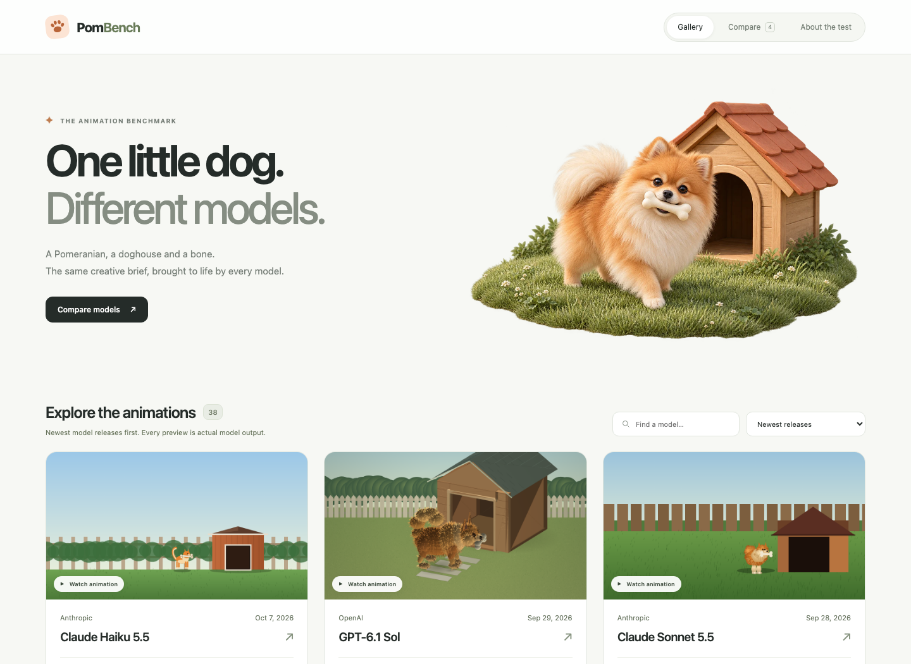

# PomBench 🐾

**One little dog. Different models.**

PomBench compares how coding models turn the same creative brief into a browser
animation: a miniature Pomeranian runs into a backyard doghouse, retrieves a bone,
backs out, and turns toward the viewer.

Every published film is a recording of the model's actual implementation.
Explore the gallery, inspect a model, or compare up to four animations on a shared
timeline, alongside generated tokens and estimated API cost.



## What you can explore

- **Gallery:** search models and sort by release date, generated tokens, or cost.
- **Model pages:** play, slow down, step through frames, and inspect the submitted
  source as plain text or open the recorded storyboard.
- **Comparison:** two or four unique models, synchronized playback, frame stepping,
  a shared seek bar, and an optional anonymous comparison with name reveal.
- **Methodology:** the scene, recording contract, repair policy, and limitations,
  presented directly on the page.

The website is in English. Model counts are data-driven so the gallery can grow
without changing its headline.

## The benchmark

The [shared initial brief](public/results/PROMPT.md) asks for a realistic
Pomeranian and convincing movement, coat volume, contact, occlusion, and object
interaction. Models choose their own visual composition and native rendering
technique. They receive no reference artwork or prescribed board layout.

Each animation lasts **12 seconds** and ends with a front-facing dog holding the
bone. It is not required to loop. The delivery contract uses a deterministic
`renderFrame(t)` and a 960 × 540 canvas, with no external assets or libraries.

Models are invoked through Microsoft Foundry APIs. Their submitted code is run
separately in offline Chromium, where **360 real frames at 30 fps** are captured
and encoded into each published film. Candidate code never runs inside the
PomBench website.

### Reading the results fairly

- A playable film proves that recording succeeded. It does **not** prove correct
  anatomy, realism, narrative completion, or artistic quality.
- PomBench does not invent an automatic aesthetic score or ask a model to grade
  its own work. Inspect the films yourself.
- Only completed, playable recordings appear in the gallery. Unfinished provider
  calls and unavailable results are not presented as empty model cards.
- The initial brief is identical. Conditional execution repairs use actual
  recorder diagnostics, without aesthetic guidance or manual code fixes. The
  final response is retained; there is no best-looking-response selection.
- The normal allowance is 32,768 output tokens, including reasoning. Provider
  ceilings and supported reasoning settings differ. Documented completion rescues
  may use 65,536 tokens and longer deadlines. This is **not an identical-budget
  comparison** across all results.
- Displayed output tokens include every retained creative response and execution
  repair. Reasoning tokens are not counted twice. Known organizer calibration
  and infrastructure replay usage are retained separately in billing metadata.
- Cost is a dated list-rate estimate, not an invoice. An asterisk marks incomplete
  usage or cost after an interrupted call. Unknown usage is never treated as zero.
- This is one constrained animation task, not a general ranking of model ability.

Older names inside the shared brief and recorded model submissions are preserved
intentionally: these artifacts retain their original bytes and hashes.

## Run locally

Requires Node.js 22.12 or newer and npm.

```sh
npm ci
npm run dev
```

Open **http://127.0.0.1:4175/**. The existing published results are included;
starting the gallery makes no paid API calls and requires no credentials.

```sh
npm run build
```

The production website is written to `dist/`. It needs no application server,
database, or inference endpoint.

## Verify

```sh
npm test
npm run check:secrets
npm run build
npm run check:build
npx playwright install chromium
npm run test:browser
npm run test:production
```

Tests cover public receipt arithmetic, source hashes, catalog ordering, playback,
synchronized comparison, mobile layout, private file exclusion, and production
content security policy. The [GitHub Actions template](docs/github-actions.yml) runs the same public checks
from a fresh checkout. Copy it into `.github/workflows/ci.yml` using a GitHub login
with workflow permissions to enable CI.
The private generation archive and its additional audit tests are not needed.

## Publish on OVH

1. Build the site with `npm ci && npm run build`.
2. In OVH, configure the selected domain's website directory separately from
   other existing websites.
3. Upload the **contents** of `dist/` to that directory using the secure transfer
   method supported by your hosting plan.
4. Enable HTTPS and verify gallery, model pages, video playback, and comparison.

Routes use URL fragments (`#gallery`, `#compare`, `#method`, and `#model/...`),
so a basic static deployment does not require application route rewrites.
The included Apache `.htaccess` applies security headers and serves model source
files as text attachments. `_headers` provides equivalent configuration for hosts
that understand that format. Confirm the actual response headers after deployment.

Only deploy `dist/`. Keep local configuration, generation scripts, credentials,
and private provider receipts outside the web root.

## Repository layout

| Path | Contents |
| --- | --- |
| `src/` | TypeScript interface, players, catalog utilities, and styles |
| `public/results/` | Sanitized published catalog, films, sources, and evidence |
| `public/assets/` | Website artwork |
| `tests/` | Public-data and browser tests |
| `scripts/` | Public build, privacy, and production checks |
| `docs/github-actions.yml` | Optional GitHub Actions verification template |

Private model-generation infrastructure is maintained separately. Its endpoint
configuration, credentials, account identifiers, raw responses, and reasoning
traces are not part of this repository. `.env.example` has empty placeholders
for optional private tooling; the public website does not read them.

## Technology

TypeScript, Vite, native HTML video, and Playwright. All displayed animations come
from the individual model submissions; the decorative website illustration is
separate from benchmark evidence.
