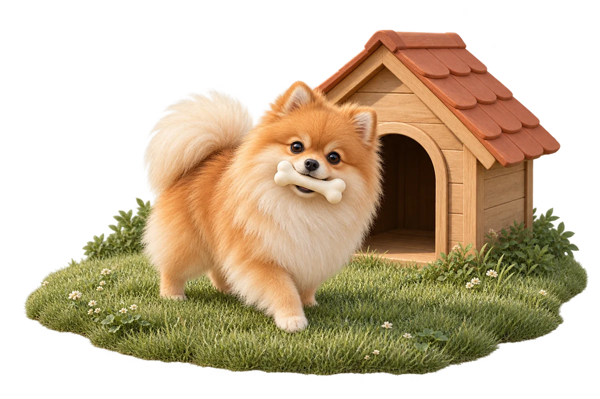

# PomBench 🐾

### One little dog. Different models.

**[Explore PomBench live →](https://pombench.com/)**

[Animation gallery](https://pombench.com/) · [Compare models](https://pombench.com/compare/) · [How the benchmark works](https://pombench.com/method/)

A visual AI coding benchmark: the same creative brief, real model-generated
animations, and the tokens and cost behind each result.

What happens when different AI models animate the same tiny dog?

PomBench gives every model the same creative challenge: bring a Pomeranian to life
as it clears a shallow puddle, lands, runs into a backyard doghouse, retrieves
a bone, and turns toward you.
The scene stays the same. The interpretations are anything but.

## Start watching

Watch [Kimi K3.1 Pro](https://pombench.com/animations/kimi-k3.1-pro/) or
[Meta Muse Wonder](https://pombench.com/animations/muse-wonder/) take on the scene,
then open the [side-by-side comparison](https://pombench.com/compare/) to explore
how different models interpret the same challenge.

## Watch the differences

A convincing animation takes more than drawing a dog. Fur needs volume. Paws need
to meet the ground. A jump needs anticipation, clearance and a believable landing,
while the water reflects the moving dog. The dog then has to disappear into the
doghouse, pick up the bone,
and turn naturally toward the viewer.

PomBench puts those choices on screen. Every animation is a recording of the
model's own code, so you can see how each model handles the same story.

## Compare models your way

- **Explore the gallery.** Find a model or sort by release date, generated tokens,
  and known API cost.
- **Watch up to four models together.** Synchronized playback makes differences
  in movement, timing, and detail easy to spot.
- **Look closer.** Slow an animation down, step through individual frames, or
  explore a model's dedicated page and storyboard.
- **Try a blind comparison.** Hide the names, watch the results, then reveal
  which model created each animation.
- **See the cost behind the result.** Compare generated tokens and known
  API spending alongside the work itself.

## One shared challenge. Room for individual expression.

Every model starts with the same brief and chooses its own composition and
rendering approach. Each recording covers twelve seconds of animation.
New results join the same gallery as the collection grows.

There is no automatic beauty score: you can judge realism, movement, and
storytelling for yourself. Recorded token usage and known API costs provide context;
model settings and completion budgets can differ. The site's [methodology page](https://pombench.com/method/)
explains how the results are produced and what the comparison can tell you.

**Same little Pomeranian. A different perspective from every model.**
